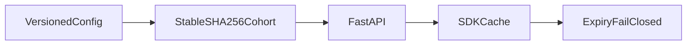

1. Serve config to clients with staged rollout, kill switch and rollback; SDK client with offline cache.

2. Result:
   Synthetic clients evaluated: 1000  
   Clients enabled at 50 percent rollout: 472  
   Offline scenarios passed: 3  

   Measured with `make bench`: [raw results](evidence/bench.json), [command output](evidence/checks.log), [environment](evidence/environment.json).

3. Architecture:


4. Run it:
```sh
make setup
make lint test bench
make demo
```

5. Decisions and limits: Original Python service and SDK with deterministic cohorts, rollback and kill switch. Versions are copied and content-addressed in memory; persistence and authenticated administration are not implemented. Network faults use real HTTP client transports with injected connection failures. Offline cached configuration remains usable for at most five seconds, so an offline client cannot observe a kill switch immediately; expiry fails closed. Existing clients refresh on get rather than background polling. See evidence/scenarios.json for rollback, cache, expiry and online kill-switch results.

6. Next: Add persistent version storage, signed configurations, authenticated publishing and background refresh.
